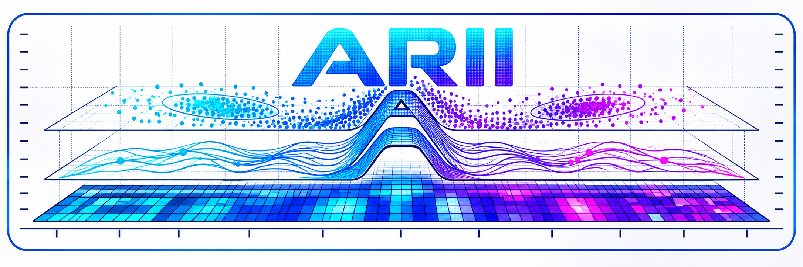

<p align="center">
  <picture>
    <source
      media="(prefers-color-scheme: dark)"
      srcset="assets/branding/readme-header.png"
    >
    <source
      media="(prefers-color-scheme: light)"
      srcset="assets/branding/readme-header-light.png"
    >
    
  </picture>
</p>

<p align="center">
  <a href="https://github.com/EXCI5ION/Arii/releases/latest">
    
  </a>
  <a href="https://doi.org/10.5281/zenodo.23167788">
    
  </a>
</p>

Arii es una aplicación de código abierto para el análisis quimiométrico de matrices ómicas. Proporciona una interfaz gráfica para
PCA, PLS-DA y OPLS-DA sobre el paquete `mixOmics`.

La ejecución local y el primer adaptador remoto Slurm comparten un contrato de trabajo. Consulte docs/cluster-execution-design.md.
La configuración inicial está disponible en la GUI; una guía sin conocimientos previos se encuentra en docs/cluster-user-guide.md.

Versión actual: **1.1.0**.

## Descargar para Windows

[Descargar Arii 1.1.0 para Windows de 64 bits](https://github.com/EXCI5ION/Arii/releases/download/v1.1.0/Arii-1.1.0-windows-x64.exe)

El instalador incluye Arii, sus workers estadísticos y un runtime privado de R
con [`mixOmics`](https://mixomics.org/).

Consulte la [última versión publicada](https://github.com/EXCI5ION/Arii/releases/latest) y
sus notas de lanzamiento.

## Instalación desde el código fuente

Arii admite **Python 3.12 o 3.13** y la serie **R 4.5.x**. Las instalaciones desde código fuente
usan [Bioconductor 3.22](https://bioconductor.org/news/bioc_3_22_release/),
compatible con R 4.5. Consulte la preparación previa en
[`docs/OS-Requirements.md`](docs/OS-Requirements.md).

### Linux — instalación global

En Debian, Ubuntu y derivados, el instalador selecciona la versión estable más reciente y prepara los comandos globales:

```bash
git clone --depth 1 https://github.com/EXCI5ION/Arii.git
cd Arii
python3 install_linux.py
```

El script solicita permisos administrativos cuando los necesita. Después de
instalar, Arii puede abrirse desde el menú de aplicaciones o por consola:

```bash
arii-gui                 # interfaz gráfica
arii --help              # interfaz de consola
sudo arii-update         # buscar e instalar una versión estable nueva
sudo arii-update --repair
sudo arii-update --uninstall
```

### macOS — instalación global

En macOS 13 o posterior, el instalador detecta Apple Silicon o Intel y prepara
un runtime privado con Python 3.12, R 4.5.3, `mixOmics` y `jsonlite`:

```bash
git clone --depth 1 https://github.com/EXCI5ION/Arii.git
cd Arii
python3 install_macos.py
```

El script solicita permisos administrativos y crea `Arii.app` en Aplicaciones,
además de los comandos:

```bash
arii-gui                    # interfaz gráfica
arii --help                 # interfaz de consola
sudo arii-update            # buscar e instalar una versión estable nueva
sudo arii-update --repair
sudo arii-update --uninstall
```

## Servidor o clúster Linux — consola

El instalador usa `curl` o `wget`. La versión del runtime es independiente de la
aplicación de escritorio; Arii 1.1.0 continúa utilizando el runtime remoto 1.0.0.
Puede instalarse en el espacio personal del usuario con:

```bash
ARII_RUNTIME_VERSION=1.0.0
wget -O install-arii-server.sh \
  "https://raw.githubusercontent.com/EXCI5ION/Arii/v${ARII_RUNTIME_VERSION}/cluster/install-server.sh"
less install-arii-server.sh
ARII_VERSION="$ARII_RUNTIME_VERSION" bash install-arii-server.sh
```

## Funcionalidades

En su versión 1.1.0, Arii permite:

- Importar matrices CSV, TSV y TXT con muestras en filas o columnas
- Trabajar con perfiles continuos y tablas de características discretas
- Asignar clases e individuos biológicos desde una tabla editable
- Aplicar centrado y escalado Pareto, de varianza unitaria o sin escalado
- Calcular PCA, PLS-DA y OPLS-DA mediante `mixOmics`
- Evaluar modelos supervisados con varias opciones de validación cruzada
- Seleccionar la complejidad del modelo y consultar las métricas estadísticas
- Explorar scores, loadings, T² de Hotelling y gráficos de valores de carga
- Explorar perfiles continuos mediante S-TOCSY interactivo desde el gráfico de
  valores de carga
- Ejecutar tests de permutaciones empíricos y comparaciones residuales
- Guardar configuración y resultados en proyectos `.arii`
- Exportar figuras ráster con dimensiones exactas
- Ejecutar modelos localmente o distribuir validaciones y permutaciones en un
  clúster Slurm.

## Ejecución en servidor o clúster

[`Arii-1.0.0-cluster-runtime-linux-x86_64.tar.gz`](https://github.com/EXCI5ION/Arii/releases/download/v1.0.0/Arii-1.0.0-cluster-runtime-linux-x86_64.tar.gz)
es exclusivamente el motor de cálculo para servidores y clústeres Linux x86-64
compatibles con glibc 2.28 o posterior.

Consulta la [guía de uso del clúster](docs/cluster-user-guide.md) y las
[instrucciones del runtime de servidor](cluster/runtime/README-SERVER.md).


## Desarrollo y pruebas

Para instalar las dependencias de desarrollo y ejecutar la suite:

```bash
python -m pip install -e ".[dev]"
python -m pytest -q
```

## Documentación

- [Manual de usuario (fuente LaTeX)](docs/main.tex)
- [Manual de usuario (PDF 1.1.0)](docs/pdf/Arii-manual-de-usuario-versión1.1.0.pdf)
- [Documentación científica (GitHub)](docs/SCIENTIFIC_DOCUMENTATION.md)
- [Documentación científica (fuente LaTeX)](docs/scientific_documentation.tex)
- [Documentación científica (PDF 1.1.0)](docs/pdf/Arii-documentacion-cientifica-versión1.1.0.pdf)
- [Referencia rápida](docs/QUICK_REFERENCE.md)
- [Índice completo de documentación](docs/README.md)

## Cómo citar

Los metadatos de autoría y versión se encuentran en
[`CITATION.cff`](CITATION.cff). GitHub puede generar desde ese archivo una
referencia en formatos APA y BibTeX.

Mientras se deposita la versión 1.1.0, utilice el DOI conceptual
[`10.5281/zenodo.23167788`](https://doi.org/10.5281/zenodo.23167788), que
representa el proyecto Arii y dirige siempre a su versión más reciente. El DOI
específico de 1.1.0 se incorporará aquí después de que Zenodo procese el release.

## Licencia

Copyright (C) 2026 Gabriel Anderson.

Arii es software libre distribuido bajo la
[GNU General Public License](LICENSE) (`GPL-3.0-or-later`). Los componentes de
terceros conservan sus propias licencias; consulta
[`THIRD_PARTY_NOTICES.md`](THIRD_PARTY_NOTICES.md).
